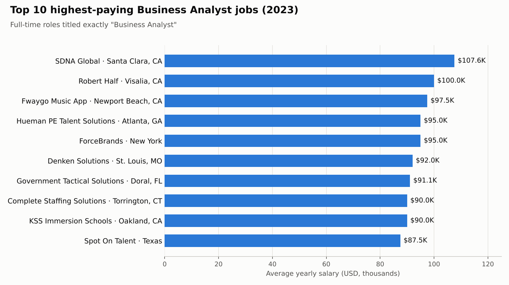
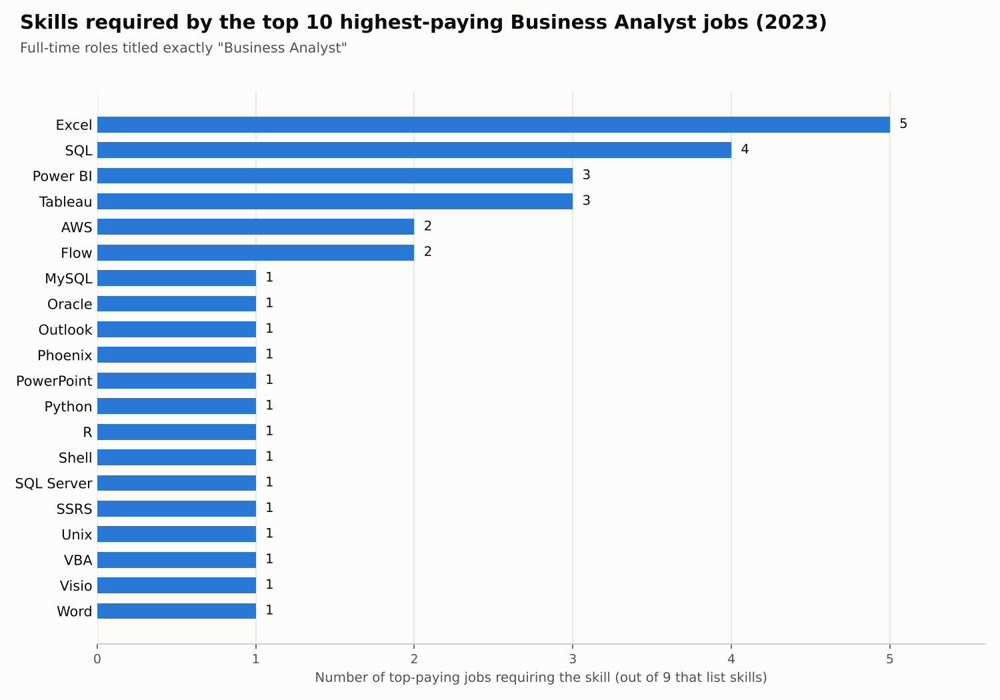
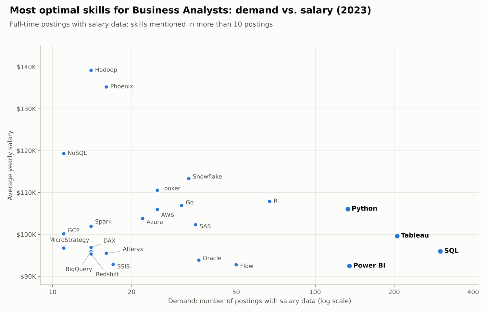

# Introduction
An SQL project exploring the 2023 job market for Business Analyst roles: which jobs pay the most, which skills employers ask for, and which skills are worth learning first.

SQL queries: [project_sql](/project_sql/)

# Background

I'm working toward a role as a Business Analyst. Before deciding what to learn next, I wanted to look at real job postings rather than guess. This project uses SQL to answer one practical question: what does the market actually want from a Business Analyst, and what is it willing to pay for?

The dataset comes from Luke Barousse's SQL for [Data Analytics course](https://lukebarousse.com/sql) and contains 2023 job postings with titles, companies, locations, salaries and required skills. The course project focuses on Data Analysts; I adapted all queries to Business Analyst roles.

### Questions
- What are the top-paying Business Analyst jobs?
- What skills do these top-paying jobs require?
- What skills are most in demand for Business Analysts?
- Which skills are associated with higher salaries?
- What are the most optimal skills to learn?

### Tools I used
- **SQL**: the core of the project. Every question was answered with a query: filtering postings, joining jobs with companies and skills, and aggregating demand and salaries.
- **PostgreSQL**: the database the job postings were loaded into. It handles a dataset of this size easily and supports everything the analysis needed, from CTEs to aggregate functions.
- **Visual Studio Code**: where I wrote and ran the queries. Connecting it directly to the database meant I could write, test and save queries in one place.
- **Git & GitHub**: used to version the SQL scripts and publish the project, so the queries and results can be reviewed and reproduced by anyone.


# The Analysis
### 1. Top-Paying Business Analyst Jobs

To find the highest-paying roles, I selected full-time postings with the exact title "Business Analyst" and a known yearly salary, joined them with company names, and kept the top 10 by salary.

```sql
SELECT
    jpf.job_id,
    cd.name AS company_name,
    jpf.job_title,
    jpf.job_location,
    jpf.job_schedule_type,
    jpf.salary_year_avg,
    jpf.job_posted_date
FROM
    job_postings_fact AS jpf
LEFT JOIN company_dim AS cd ON jpf.company_id = cd.company_id
WHERE
    jpf.job_title = 'Business Analyst' AND
    jpf.job_schedule_type = 'Full-time' AND
    jpf.salary_year_avg IS NOT NULL
ORDER BY
    jpf.salary_year_avg DESC
LIMIT 10;
```
**Findings:**
- **Salary range:** the top 10 roles pay from **$87,500 to $107,600** per year, with an average of about **$94,600**. The range is narrow: once Senior and Lead titles are excluded, even the best-paid regular BA jobs stay around $90K–$110K.
- **Employers:** a mix of tech companies (SDNA Global, Fwaygo Music App), staffing agencies (Robert Half, Spot On Talent, Hueman, Complete Staffing Solutions) and other sectors such as government contracting and education, so BA roles aren't tied to a single industry.
- **Location:** all top roles are in the US, with California appearing most often, followed by New York, Texas, Georgia, Missouri, Florida and Connecticut.


*Bar chart of the top 10 highest-paying Business Analyst jobs in 2023*

### 2. Skills for Top-Paying Jobs

To see what the best-paid Business Analyst roles require, I reused the top 10 jobs from the first query as a CTE and joined them with the skills tables.

```sql
WITH top_paying_jobs AS (
    SELECT
        jpf.job_id,
        cd.name AS company_name,
        jpf.job_title,
        jpf.job_location,
        jpf.job_schedule_type,
        jpf.salary_year_avg,
        jpf.job_posted_date
    FROM
        job_postings_fact AS jpf
    LEFT JOIN company_dim AS cd ON jpf.company_id = cd.company_id
    WHERE
        jpf.job_title = 'Business Analyst' AND
        jpf.job_schedule_type = 'Full-time' AND
        jpf.salary_year_avg IS NOT NULL
    ORDER BY
        jpf.salary_year_avg DESC
    LIMIT 10
)

SELECT
    tpj.*,
    sd.skills
FROM 
    top_paying_jobs AS tpj
INNER JOIN skills_job_dim AS sjd ON tpj.job_id = sjd.job_id
INNER JOIN skills_dim AS sd ON sjd.skill_id = sd.skill_id
ORDER BY
    tpj.salary_year_avg DESC;
```

**Findings** (9 of the 10 jobs list their skills):
- **Excel** leads, appearing in **5** of 9 jobs. It is still the everyday tool of a Business Analyst.
- **SQL** follows with **4**. Counting specific databases too (MySQL, SQL Server, Oracle), database skills appear almost as often as Excel.
- **Power BI** and **Tableau** appear in **3** jobs each. Together with SSRS, BI tools appear in 5 of 9 jobs, so building reports and dashboards is a core part of the role.
- **More technical skills come with higher pay.** The best-paid job (SDNA Global, ~$107.6K) has the most technical stack: SQL, several databases, AWS, Unix and Shell. Jobs that mention SQL average ~$98K, versus ~$93.5K for jobs that mention Excel.



*Bar chart of how often each skill appears in the top 10 highest-paying Business Analyst jobs*

### 3. Most In-Demand Skills

To see what the market asks for overall, not only in the top-paying jobs, I counted how often each skill appears across all Business Analyst postings (using the broader `job_title_short` category, which includes senior and specialised BA roles).

```sql
SELECT
    skills,
    COUNT(job_postings_fact.job_id) AS demand_for_skill
FROM 
    job_postings_fact
INNER JOIN skills_job_dim ON job_postings_fact.job_id = skills_job_dim.job_id
INNER JOIN skills_dim ON skills_job_dim.skill_id = skills_dim.skill_id
WHERE
    job_title_short = 'Business Analyst'
GROUP BY
    skills
ORDER BY
    demand_for_skill DESC
LIMIT 10;
```

| Skill      | Demand |
|------------|-------:|
| SQL        | 17,372 |
| Excel      | 17,134 |
| Tableau    |  9,324 |
| Power BI   |  9,251 |
| Python     |  8,097 |
| PowerPoint |  4,591 |
| R          |  4,035 |
| Word       |  3,675 |
| SAP        |  3,651 |
| SAS        |  3,604 |

**Findings:**
- **SQL and Excel are the foundation.** They are almost tied (~17K postings each) and appear about twice as often as any other skill.
- **BI tools come next.** Tableau and Power BI are nearly equal (~9.3K each), so either one is a solid choice. What matters is knowing at least one.
- **Python is close behind** with ~8.1K postings. It appeared only once in the top-paying jobs, but across the wider market it is becoming a common requirement.
- **Business tools still matter.** PowerPoint, Word, SAP and SAS round out the top 10, showing that the role combines data work with presenting results and working inside enterprise systems.

### 4. Skills Based on Salary

To find which skills pay the most, I calculated the average yearly salary of Business Analyst postings for each skill.

```sql
SELECT
    skills,
    ROUND(AVG(salary_year_avg), 0) AS avg_salary
FROM 
    job_postings_fact
INNER JOIN skills_job_dim ON job_postings_fact.job_id = skills_job_dim.job_id
INNER JOIN skills_dim ON skills_job_dim.skill_id = skills_dim.skill_id
WHERE
    job_title_short = 'Business Analyst' AND
    salary_year_avg IS NOT NULL
GROUP BY
    skills
ORDER BY
     avg_salary DESC
LIMIT 25;
```

| Skill      | Average Salary ($) |
|------------|-------------------:|
| Chef       | 220,000 |
| NumPy      | 157,500 |
| Ruby       | 150,000 |
| Hadoop     | 139,201 |
| Julia      | 136,100 |
| Airflow    | 135,410 |
| Phoenix    | 135,248 |
| Electron   | 131,000 |
| C          | 123,329 |
| PyTorch    | 120,333 |

*Table of the top 10 highest-paying skills for Business Analysts*

**Findings:**
- **Data science and machine learning pay a premium.** Python libraries and ML frameworks (NumPy, PyTorch, TensorFlow, scikit-learn, Pandas, Matplotlib, Seaborn) fill much of the top 25, with average salaries of $110K–$157K.
- **Big data and data engineering tools come next.** Hadoop, Airflow, Snowflake and databases such as MongoDB, Cassandra and other NoSQL systems point to BA roles that work closely with data pipelines and infrastructure.
- **Programming languages add value.** Ruby, Julia, C and MATLAB also make the list, so analysts who can code are paid more.
- **The core skills are absent.** SQL, Excel, Tableau and Power BI, the most in-demand skills from question 3, don't appear in the top 25. They are expected of everyone, so they don't earn a premium.
- **Small samples inflate some numbers.** Several skills (for example Chef, a DevOps tool, at $220K) probably come from just one or a few postings, so the exact ranking is noisy. Question 5 fixes this by adding a minimum demand threshold.

### 5. Most Optimal Skills to Learn

Finally, I combined demand and salary to find skills that are both in demand and well paid. To avoid the small-sample problem from question 4, I kept only skills that appear in more than 10 full-time postings with salary data.

```sql
SELECT
    skills_dim.skill_id,
    skills_dim.skills,
    COUNT(job_postings_fact.job_id) AS demand_for_skill,
    ROUND(AVG(salary_year_avg), 0) AS avg_salary
FROM 
    job_postings_fact
INNER JOIN skills_job_dim ON job_postings_fact.job_id = skills_job_dim.job_id
INNER JOIN skills_dim ON skills_job_dim.skill_id = skills_dim.skill_id
WHERE
    job_title_short = 'Business Analyst' 
    AND salary_year_avg IS NOT NULL 
    AND job_schedule_type = 'Full-time'
GROUP BY
    skills_dim.skill_id
HAVING
    COUNT(job_postings_fact.job_id) > 10
ORDER BY
    avg_salary DESC
LIMIT 25;
```

*I also wrote the same query using two CTEs (one for demand, one for salary). Both versions are in the [project_sql folder](/project_sql/).*

| Skill         | Demand | Average Salary ($) |
|---------------|-------:|-------------------:|
| Hadoop        | 14  | 139,201 |
| Phoenix       | 16  | 135,248 |
| NoSQL         | 11  | 119,330 |
| Snowflake     | 33  | 113,377 |
| Looker        | 25  | 110,581 |
| R             | 67  | 107,920 |
| Go            | 31  | 106,902 |
| Python        | 133 | 106,079 |
| AWS           | 25  | 105,996 |
| Azure         | 22  | 103,836 |
| SAS           | 35  | 102,323 |
| Spark         | 14  | 101,999 |
| GCP           | 11  | 100,221 |
| Tableau       | 205 |  99,672 |
| DAX           | 14  |  96,950 |
| MicroStrategy | 11  |  96,763 |
| SQL           | 300 |  96,010 |
| BigQuery      | 14  |  95,946 |
| Alteryx       | 16  |  95,497 |
| Redshift      | 14  |  95,388 |
| Oracle        | 36  |  93,921 |
| SSIS          | 17  |  92,889 |
| Flow          | 50  |  92,837 |
| Power BI      | 135 |  92,481 |

*SAS is stored twice in `skills_dim` (IDs 7 and 186) with identical results, so it is shown once.*

**Findings:**
- **Python is the strongest all-round choice.** With 133 postings and an average of ~$106K, it combines high demand with a salary above the core BA tools.
- **SQL and Tableau are essential but not premium.** SQL is by far the most demanded skill (300 postings) and Tableau is second (205), but both pay around $96K–$100K. They get you hired more than they raise your salary.
- **Cloud and modern data platforms pay more.** Snowflake, AWS, Azure, GCP and Looker sit in the $100K–$113K range with moderate demand, a good next step after the basics.
- **Big data skills top the salary list, but are niche.** Hadoop, Phoenix and NoSQL pay $119K–$139K but appear in only 11–16 postings each.
- **Power BI is in demand but pays the least** in this list (~$92K across 135 postings), likely because it's common in more junior and generalist BA roles.


*Scatter plot of skill demand vs. average salary for Business Analysts*

# What I learned

This project was my first full analysis in SQL, from raw tables to conclusions. Along the way I picked up both technical skills and a more critical way of reading data:

- **Joining tables:** combining job postings, companies and skills with `LEFT JOIN` and `INNER JOIN`, and using table aliases to keep longer queries readable. I also saw how the choice of join changes the result: in question 2, an `INNER JOIN` on skills quietly dropped one of the top 10 jobs because it had no skills listed.
- **CTEs:** using `WITH` to split a problem into clear steps, for example reusing the top 10 jobs from question 1 as the base for question 2, and building question 5 from separate demand and salary subqueries.
- **Aggregation:** grouping data with `GROUP BY`, summarising it with `COUNT()`, `AVG()` and `ROUND()`, and filtering groups with `HAVING`. I wrote question 5 both with CTEs and as a single query with `HAVING` to compare the two approaches.
- **Defining the scope:** the filter decides the answer. Filtering on the exact title `'Business Analyst'` versus the broader `job_title_short` category gave very different salary ranges, so every result needs a clear statement of what was included.
- **Reading results critically:** a high average salary based on one or two postings means little, so I learned to check how many records stand behind each number. I also learned to watch for data quality issues, like the same skill (SAS) being stored twice in the skills table.

# Conclusions
### Insights

1. **Top-paying Business Analyst jobs:** full-time roles titled exactly "Business Analyst" top out at $87.5K–$107.6K, with an average of about $94.6K. The range is narrow, and higher salaries come with Senior, Lead and more technical titles.
2. **Skills for top-paying jobs:** the best-paid roles are built on Excel, SQL and a BI tool (Power BI or Tableau). The highest-paying job also had the most technical stack (databases, AWS, Unix), which suggests technical depth raises the ceiling.
3. **Most in-demand skills:** SQL and Excel are the clear foundation of the BA job market (~17K postings each), followed by Tableau, Power BI and Python.
4. **Skills with higher salaries:** the highest averages belong to data science, big data and programming skills (NumPy, Hadoop, Airflow, Python ML libraries). Core skills like SQL and Excel are expected of everyone, so they don't earn a premium on their own.
5. **Most optimal skills:** Python offers the best balance of demand and salary. SQL and Tableau are the most demanded skills but pay closer to the average, while cloud platforms (Snowflake, AWS, Azure) are a well-paid next step once the basics are covered.

### Closing Thoughts

This project improved my SQL skills and gave me a data-based view of the Business Analyst job market: what employers expect, which skills are most valued and how pay changes with technical depth. More broadly, it showed me that good analysis depends on asking precise questions, defining the scope carefully and always checking how much data stands behind each conclusion.